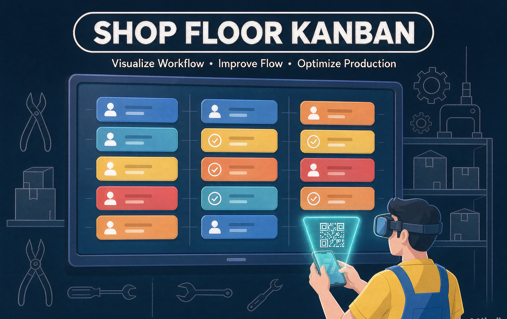

# Shop Floor Kanban

A lightweight, zero-build job-order kanban system for small workshops: sales reps create work orders on a desktop, a TV in the workshop displays them full-screen, and workers update progress or ask questions from their phones. Pure static front-end plus a hosted cloud database — no server code, no build step, no framework.

> **⚠️ Unmaintained / as-is.** This was a one-off project built for a specific workshop and is published for reference only. There will be **no updates, no bug fixes, and no issue monitoring**. If it is useful to you, fork it and make it yours.

## What it does

| Page | Purpose |
|---|---|
| `index.html` | Landing page with QR codes to the other pages |
| `admin.html` | Order desk: create / edit orders, upload attachments, manage staff accounts and quick-process chips |
| `kanban.html` | TV board: full-screen kanban for the workshop wall |
| `feedback.html` | Worker page (mobile): scan the QR on the TV card → update status, attach photos / voice notes, ask questions, download attachments |

### Highlights

- **TV mode** (`kanban.html?tv=1`) — auto fullscreen prompt, Screen Wake Lock, hidden cursor, auto paging when orders exceed one screen, scheduled self-refresh to stay snappy for weeks of uptime, offline banner.
- **Sound alerts** — synthesized tones (no audio files) for new orders, rush orders, and unanswered worker questions. Click-to-unlock for browser autoplay policy, mute badge, `?mute=1` to start muted.
- **Rush orders & question threads** — rush orders are pinned and tinted red; unanswered worker questions float to the top with a highlight bar until replied.
- **Quick-process chips** — admin-defined craft keywords (e.g. laser cutting, drilling) stored in a settings table; picked chips render as bubbles on the board, free-text notes render separately.
- **Attachments** — images/documents embedded as data URLs (size and count capped), downloadable from the worker page.
- **Order numbers** — generated server-side (cloud max + 1) so concurrent desks can't collide.
- **Per-owner view** — staff accounts only see their own orders; `?owner=Name` filters the TV board.
- **Kiosk deployment** — `tv-kiosk/` ships Windows autostart scripts and notes for Android TV boxes via Fully Kiosk Browser.

## Tech notes

- Vanilla HTML/CSS/JS. The only vendored dependency is a small QR code lib (`lib/qrcode.min.js`).
- All cloud access is isolated in `app.js`. The integration surface is two constants at the top (`CLOUD_ENDPOINT`, `CLOUD_PUBLISHABLE_KEY`) plus a tiny sync API (list / upsert orders, read/write settings). Swap in any backend you like.
- Data lives in three tables: `orders` (whole order as JSONB payload, attachments included), `users` (name / password hash / role), `settings` (key-value, e.g. chip word list).
- **Security caveat**: the bundled publishable key and open RLS were deliberate for a private, low-stakes workshop deployment. If you reuse this, put a real backend with authentication in between — treat the data as public otherwise.
- UI text is Simplified Chinese (built for one specific workshop). No i18n is planned.

## Deploying your own copy

1. Host the static files anywhere (nginx, GitHub Pages, any static host or CDN).
2. Point `CLOUD_ENDPOINT` / `CLOUD_PUBLISHABLE_KEY` in `app.js` to your own backend (or adapt `app.js` to talk to Supabase/Firebase — the data layer is ~100 lines).
3. Open `kanban.html?tv=1` on the workshop TV; for Android TV boxes, install Fully Kiosk Browser and set that URL as the Start URL with "Launch on Boot" and "Keep Screen On" enabled.

## License

[MIT](LICENSE)
